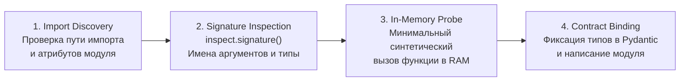
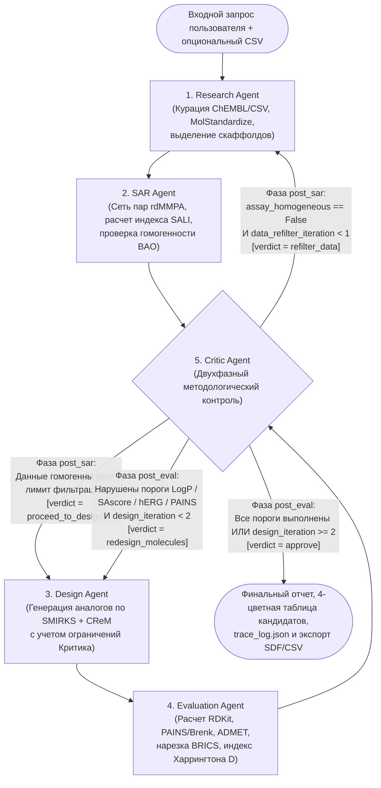

# Архитектурная спецификация системы (`ARCHITECTURE.md`)

**Проект:** Мультиагентная система анализа зависимостей «структура–активность» (SAR) и направленного дизайна малых молекул (`pishovichok`)  
**Версия архитектуры:** 1.1.0  
**Связанный документ:** [SPEC.md](file:///home/arutamonofu/projects/pishovichok/SPEC.md)

---

## 1. Программный стек по 5 слоям и стратегия каскадных фолбэков (Zero-Failure Guarantee)

Система спроектирована для развертывания в **едином локальном окружении Python 3.12 (`uv`)** без внешней микросервисной инфраструктуры (Docker, Redis, внешние СУБД не требуются). Целевое время полного цикла выполнения запроса (включая до 2 итераций самокоррекции) — **2–10 секунд** на стандартном CPU.

### 1.1. Матрица стека по 5 архитектурным слоям

| Слой | Назначение слоя | Основные библиотеки и версии | Бюджет времени на цикл |
| :--- | :--- | :--- | :--- |
| **Слой 1. Вычислительный слой (Детерминированное ядро)** | Курация структур, SQL-аналитика по локальным слепкам, поиск парных соответствий (MMP), расчет SALI, генерация аналогов, расчет дескрипторов RDKit, фильтров PAINS/Brenk, ретросинтез BRICS, прогноз ADMET и скоринг Харрингтона | `rdkit>=2024.3.5`, `duckdb>=1.1.0`, `pyarrow>=17.0.0`, `pandas>=2.2.0`, `numpy>=2.0.0`, `crem>=0.2.10` (опц. / встроенный движок), `catboost>=1.2.7`, `scikit-learn>=1.5.0`, `chembl-webresource-client>=0.10.9` (опц. сетевой фолбэк), `admet-ai>=1.3.0` (опц. плагин) | **1.0 – 3.5 с** (пакетная обработка 50–350 молекул в C++ ядре RDKit и векторизованном DuckDB) |
| **Слой 2. Слой состояния и адаптации данных (State & Adapters)** | Строгие контракты данных, разделение 4 категорий знаний, управление сессионным хранилищем Parquet («толстые указатели» / Fat Pointers), сериализация трассировки | `pydantic>=2.9.0`, `pydantic-settings>=2.5.0`, `pyarrow>=17.0.0`, `duckdb>=1.1.0` | **< 0.1 с** (передача только URI и компактных агрегатов в памяти) |
| **Слой 3. Слой агентной оркестрации (LangGraph)** | Конечный автомат из 5 агентов, семантический парсинг запросов, условная маршрутизация, две замкнутые петли самокоррекции, синтез научных объяснений | `langgraph>=0.2.35`, `langchain-core>=0.3.10`, `langchain-openai>=0.2.2`, `httpx>=0.27.0` | **0.5 – 4.0 с** (зависит от режима LLM; **< 0.05 с** в детерминированном Rule-Based фолбэке) |
| **Слой 4. Слой интерфейса и трассируемости (NiceGUI 4.0 Chemical IDE)** | Трёхпанельная рабочая среда: оркестрация графа + HITL-шлюз + скетчер JSME, интерактивный MPO-холст (`ui.echart`) и виртуализированная таблица (`ui.aggrid`), инспектор 2D/3D (ETKDGv3 + `3Dmol.js`) и 4-категорийного provenance | `nicegui>=4.0.0`, локальные статические ассеты `3Dmol-min.js` и `jsme`, `core/rendering.py` (`rdMolDraw2D` в `run.cpu_bound`) | **0.1 – 0.3 с** (ленивые HTTP SVG-эндпоинты с кэшированием и инкрементальные транзакции AG Grid) |
| **Слой 5. Инфраструктурный слой (DevOps и воспроизводимость)** | Управление зависимостями, предкэшированные эталонные датасеты ChEMBL, локальная база фрагментов и весов моделей, экспорт артефактов для грантовых отчетов | `uv` (`uv_build`), `pytest>=8.3.0`, `ruff>=0.7.0`, файловый кэш `/data` (Parquet, SQLite, JSON/CBM) и `/workspace/<session_id>` | **0 с** сетевых задержек при работе по предкэшированным данным |

---

### 1.2. Стратегия отказоустойчивости и каскадных фолбэков (Zero-Failure Guarantee)

Чтобы гарантировать безотказную работу системы в закрытом контуре НИИ, при отсутствии интернета, ключей LLM API или тяжелых GPU-зависимостей, каждый внешний или ресурсоемкий компонент обернут в адаптер с автоматическим каскадом фолбэков:

```mermaid
flowchart TD
    subgraph LLM_Cascade["Каскад 1: Языковая модель (Слой 3)"]
        L1["Уровень 1: Облачный OpenAI-совместимый API\n(OpenAI / DeepSeek / OpenRouter / vLLM)"]
        L2["Уровень 2: Локальный сервер Ollama / llama.cpp\n(http://localhost:11434/v1)"]
        L3["Уровень 3: Deterministic Rule-Based Engine\n(Regex/AST-парсер ограничений + шаблонные вердикты и гипотезы)"]
        L1 -->|"Таймаут > 4с / Нет API-ключа / Сетевая ошибка"| L2
        L2 -->|"Недоступен локальный порт"| L3
    end

    subgraph Data_Cascade["Каскад 2: Источник данных биоактивности (Слой 1)"]
        D1["Уровень 1: Локальный кэш Parquet (/data/chembl/*.parquet)\n(Мгновенное чтение через DuckDB за ~15 мс)"]
        D2["Уровень 2: REST API ChEMBL (chembl_webresource_client)\nс автосохранением в локальный Parquet"]
        D3["Уровень 3: Синтетический / эталонный слепок мишени\nиз резервного набора (/data/chembl/fallback_targets.parquet)"]
        D1 -->|"Мишень отсутствует в локальном кэше"| D2
        D2 -->|"Нет сети / Таймаут API > 5с"| D3
    end

    subgraph Gen_Cascade["Каскад 3: Генератор молекулярных структур (Слой 1)"]
        G1["Уровень 1: Применение извлеченных правил rdMMPA (SMIRKS)\nиз экспериментальной выборки"]
        G2["Уровень 2: Локальная компактная база CReM (/data/crem/replacements_sa2.db)\nпри фиксированном скаффолде Bemis-Murcko"]
        G3["Уровень 3: Встроенный курированный каталог из 45+ медико-химических\nбиоизостерных SMIRKS-реакций RDKit (с направленным сдвигом ΔLogP / ΔTPSA)"]
        G1 -->|"Мало правил (< 5 кандидатов) или уникальное ядро"| G2
        G2 -->|"Файл БД CReM отсутствует или нет совпадений контекста"| G3
    end

    subgraph ADMET_Cascade["Каскад 4: Прогноз ADMET и токсичности (Слой 1)"]
        A1["Уровень 1: Пакет admet-ai (Chemprop D-MPNN)\nпри наличии установленного пакета и весов"]
        A2["Уровень 2: Локальные легковесные модели CatBoost (/data/models/*.cbm)\nна Morgan FP (r=2, 2048 бит) + 8 дескрипторах RDKit"]
        A3["Уровень 3: Аналитические QSAR-модели на дескрипторах RDKit\n(Delaney ESOL для LogS, Egan/BOILED-Egg для BBB, эмпирический скоринг hERG и CYP450)"]
        A1 -->|"Пакет не установлен / CPU-таймаут"| A2
        A2 -->|"Файлы весов .cbm не найдены"| A3
    end
```



#### Детализация правил переключения и прозрачности фолбэков:
1. **Прозрачная маркировка источника (Provenance Tracking):** Ни один фолбэк не маскируется под более сложную модель. В контракте `PredADMETMetrics` обязательно заполняется поле `model_source: Literal["admet_ai_dmpnn", "catboost_local_qsar", "rdkit_analytical_qsar"]`, а в трассировке агентов (`TraceEvent`) фиксируется причина переключения (`fallback_reason`).
2. **Гарантия для SAscore:** Расчет индекса синтетической доступности Ertl (`SAscore` в диапазоне `[1.0, 10.0]`) реализуется через штатный модуль `rdkit.Chem.RDConfig.RDContribDir` (`SA_Score/sascorer.py`), поставляемый внутри бинарного пакета `rdkit`, с резервной встроенной формулой топологической сложности на случай нестандартной сборки `RDKit`.
3. **Предкэшированные мишени в `/data/chembl/`:** Для мгновенной работы без интернета в репозиторий включаются Parquet-слепки по трем базовым мишеням из [SPEC.md](file:///home/arutamonofu/projects/pishovichok/SPEC.md):
   - `CHEMBL203.parquet` (EGFR — рецептор эпидермального фактора роста, онкология);
   - `CHEMBL5251.parquet` (BTK — тирозинкиназа Брутона, аутоиммунные заболевания);
   - `CHEMBL262.parquet` (GSK-3beta — киназа гликогенсинтазы 3-бета, нейродегенеративные патологии).  
   Каждый слепок содержит реальные записи с преднамеренно сохраненной гетерогенностью протоколов (`BAO_0000357` — биохимический белковый тест и `BAO_0000219` — клеточный тест), чтобы детерминированно демонстрировать срабатывание **Петли самокоррекции №1 (`refilter_data`)**.

---

## 2. Протокол предварительной верификации API (API Pre-Verification Protocol)

### 2.1. Императивное правило предварительной верификации рантайма

> [!CAUTION]
> ### ЖЕСТКИЙ РЕГЛАМЕНТ РАЗРАБОТКИ МОДУЛЕЙ
> **Перед написанием кода любого функционального модуля на последующих этапах категорически запрещается полагаться на умозрительные предположения, примеры из устаревшей документации или галлюцинации LLM относительно сигнатур функций, аргументов и путей импорта.**  
> Разработчик / ИИ-агент обязан **программно выполнить интроспекцию фактически установленных в окружении библиотек** в среде Python и зафиксировать реальные пути импорта, имена аргументов, дефолтные значения и контракты возвращаемых типов до формирования целевого файла кода.

### 2.2. Четырехэтапный протокол интроспекции рантайма

Перед реализацией каждого модуля выполняется сквозной 4-этапный протокол:



1. **Этап 1: Import Discovery (Обнаружение пути импорта)**  
   Проверка реального размещения класса/функции в установленном пакете (например, различие между `rdkit.Chem.rdMolStandardize.Cleanup` и `rdkit.Chem.MolStandardize.rdMolStandardize.Cleanup`, расположение `AllChem.GetMorganGenerator` vs legacy `AllChem.GetMorganFingerprintAsBitVect`).
2. **Этап 2: Signature & Parameter Inspection (Интроспекция сигнатур)**  
   Чтение сигнатуры через `inspect.signature(func)` или встроенный `help(func)`. Выявление обязательных позиционных аргументов, точных названий ключевых параметров (например, `maxCuts` vs `max_cuts`, `resultsAsMols` vs `asMols` в `rdMMPA.FragmentMol`, `extra="forbid"` в Pydantic v2 `ConfigDict`).
3. **Этап 3: Minimal In-Memory Probe (Синтетический тестовый запуск)**  
   Однострочное исполнение исследуемой операции на тривиальных входных данных (например, молекула бензола `c1ccccc1`, словарь из 2 полей или таблица DuckDB из 1 строки) без обращения к диску и сети. Проверка типа возвращаемого значения (`isinstance`, `type(res)`).
4. **Этап 4: Contract Binding (Связывание контрактов)**  
   Код адаптера или чистой функции оформляется со строгими аннотациями типов Python (`typing`) строго в соответствии с подтвержденным контрактом интроспекции.

### 2.3. Стандартизированный инструмент интроспекции (`tools/verify_api.py`)

Для автоматизации регламента в проекте закрепляется процедура запуска скрипта интроспекции через CLI:

```python
# tools/verify_api.py (шаблон регламентной проверки перед реализацией модуля)
import inspect
from typing import Any


def verify_interface(
    target_obj: Any,
    expected_callable: str,
    sample_args: tuple = (),
    sample_kwargs: dict | None = None,
) -> dict[str, Any]:
    sample_kwargs = sample_kwargs or {}
    attr = getattr(target_obj, expected_callable, None)
    if attr is None:
        raise AttributeError(f"API Mismatch: {target_obj} does not have attribute '{expected_callable}'")
    
    sig = inspect.signature(attr) if callable(attr) else None
    result = None
    exec_error = None
    if callable(attr) and sample_args:
        try:
            result = attr(*sample_args, **sample_kwargs)
        except Exception as e:
            exec_error = str(e)
            
    return {
        "attribute": expected_callable,
        "is_callable": callable(attr),
        "signature": str(sig) if sig else "N/A",
        "sample_run_success": exec_error is None,
        "result_type": type(result).__name__ if result is not None else None,
        "error": exec_error,
    }
```

### 2.4. Спецификация критических ловушек (Gotchas) и несовместимостей по версиям

В таблице ниже зафиксированы исторически уязвимые интерфейсы хемоинформатического стека, подлежащие обязательной проверке:

| Модуль / Библиотека | Потенциальная ошибка / Ловушка предположений | Фактический подтвержденный стандарт интерфейса |
| :--- | :--- | :--- |
| **`rdkit.Chem.rdMolStandardize`** | Вызов `LargestFragmentChooser().choose_mol(mol)` вместо верного метода. | Метод называется строго `.choose(mol)`! Возвращает новый `Chem.Mol`. |
| **`rdkit.Chem.rdMolStandardize`** | `TautomerEnumerator().Canonicalize()` возвращает `None` при исчерпании лимита таутомеров (`maxTransforms`). | Обязательно проверять возврат на `None` и иметь детерминированный фолбэк на исходный родительский `Mol`. |
| **`rdkit.Chem.rdMMPA`** | Передача `max_cuts=1` в snake_case вместо camelCase. | Параметр строго в camelCase: `rdMMPA.FragmentMol(mol, maxCuts=1, maxPath=1, resultsAsMols=False)`. Возвращает `list[tuple[str, str]]` (core, chains). |
| **`rdkit.Chem.rdMolDraw2D`** | Предположение о нормализации RGB-цветов в диапазоне 0..255. | В `rdMolDraw2D` цвета нормализованы строго в `[0.0, 1.0]`: зеленый — `(0.1, 0.8, 0.2)`, красный — `(0.9, 0.2, 0.2)`. |
| **`rdkit.Chem.BRICS`** | Ожидание очищенных SMILES без фиктивных меток. | `BRICS.BRICSDecompose` возвращает множество с изотопными метками точек разрыва вида `[1*]`, `[3*]`. Требуется регуляризация через `Chem.ReplaceSubstructs` или канонизация. |
| **`pydantic` v2** | Использование устаревших методов v1: `.dict()`, `.parse_obj()`, `class Config`. | В Pydantic v2 строго: `.model_dump()`, `.model_dump_json()`, `.model_validate()`, `model_config = ConfigDict(extra="forbid", frozen=True)`. |
| **`duckdb`** | Попытка чтения Parquet через промежуточное создание постоянных таблиц. | Чтение напрямую из файла через векторизованный скан: `duckdb.connect().execute("SELECT * FROM 'path.parquet' WHERE ...").arrow()`. |
| **`langgraph`** | Мутирование входного словаря `state` внутри узлов. | Узел графа возвращает **новый частичный словарь обновлений** (`return {"last_executed_stage": "sar", ...}`). |

---

## 3. Ревизия библиотек и интеграций по 5 слоям системы (Интерфейсы, Форматы I/O, Точки проверки и Фолбэки)

Ниже представлена детальная ревизия всех 11 критичных инструментов и функциональных областей системы по 5 слоям.

### 3.1. Валидация схем и табличное хранилище (`pydantic` v2, `duckdb`, `pyarrow`) — Слой 1 и 2

* **Назначение:** Описание строгих контрактов данных, управление сессионными таблицами на диске, реализация паттерна Fat Pointers без перегрузки контекста LLM.
* **Критичные интерфейсы:**
  - `pydantic.BaseModel`: методы `.model_validate(dict_obj)`, `.model_dump()`, `.model_dump_json()`, класс конфигурации `ConfigDict(extra="forbid", frozen=True)`.
  - `duckdb`: `duckdb.connect(database=":memory:")`, `conn.execute(sql, parameters)`, `conn.sql(query).arrow()`, `conn.sql(query).df()`, чтение `SELECT * FROM read_parquet('path.parquet')`.
  - `pyarrow.parquet`: `pq.read_table(path, columns=...)`, `pq.write_table(table, path, compression="zstd")`, `pa.Table.from_pandas(df)`.
* **Форматы входных / выходных данных:**
  - *Вход:* Сессионные пути к файлам `.parquet`, SQL-запросы, сырые словари Python.
  - *Выход:* Строго типизированные Pydantic-объекты (`CandidateMolecule`, `ParquetPointer`), таблицы `pa.Table` или `pd.DataFrame`.
* **Точки обязательной проверки интроспекцией:**
  - Совместимость версий `pydantic>=2.9.0`: отсутствие предупреждений о deprecation при `ConfigDict(extra="forbid")`.
  - Прямая конвертация `duckdb.Relation.arrow()` в `pyarrow.Table` без промежуточной сериализации на диск.
* **Детерминированный локальный фолбэк:**
  - DuckDB и PyArrow функционируют на 100% локально в памяти процесса C++. При повреждении одного Parquet-файла активируется прямое чтение через резервный движок `pyarrow.parquet.read_table` с валидацией контрольной суммы `sha256`.

---

### 3.2. Стандартизация молекул (`rdkit.Chem`, `rdkit.Chem.rdMolStandardize`, `MurckoScaffold`) — Слой 1

* **Назначение:** Очистка сырых структур ChEMBL и CSV, удаление солей, нейтрализация зарядов, канонизация таутомеров, выделение скаффолдов Bemis-Murcko.
* **Критичные интерфейсы:**
  - `Chem.MolFromSmiles(smiles, sanitize=True)`
  - `Chem.MolToSmiles(mol, canonical=True, isomericSmiles=True)`
  - `Chem.MolToInchiKey(mol)`
  - `rdMolStandardize.Cleanup(mol)`
  - `rdMolStandardize.LargestFragmentChooser().choose(mol)`
  - `rdMolStandardize.Uncharger().uncharge(mol)`
  - `rdMolStandardize.TautomerEnumerator().Canonicalize(mol)`
  - `MurckoScaffold.GetScaffoldForMol(mol)`
* **Форматы входных / выходных данных:**
  - *Вход:* Сырая строка SMILES (`str`), флаг источника (`source_dataset: str`).
  - *Выход:* Кортеж `(canonical_smiles: str, inchi_key: str, scaffold_smiles: str)` при успехе; `None` с записью ошибки в `validation_errors_log` при невалидной валентности.
* **Точки обязательной проверки интроспекцией:**
  - Метод `LargestFragmentChooser().choose(mol)` возвращает очищенный `Mol` (не `choose_mol`!).
  - Лимит времени/трансформаций `TautomerEnumerator().Canonicalize`: поведение при циклических таутомерах.
* **Детерминированный локальный фолбэк:**
  - Если `TautomerEnumerator.Canonicalize` завершается сбоем или превышает лимит шагов — срабатывает каскадный откат: `Cleanup` -> `LargestFragmentChooser` -> `Uncharger` без таутомерного преобразования.
  - При синтаксической невалидности SMILES строка изолируется в `raw_dataset.parquet` с пометкой `is_valid = False` без прерывания общего пайплайна.

---

### 3.3. Парная фрагментация и расчет SAR-метрик (`rdkit.Chem.rdMMPA`, `DataStructs`, `MorganGenerator`) — Слой 1

* **Назначение:** Разложение молекулярных графов на общие ядра и заместители, нахождение парных соответствий (MMP), расчет среднего сдвига $\Delta\text{pIC}_{50}$, расчет индекса SALI и выявление Activity Cliffs.
* **Критичные интерфейсы:**
  - `rdMMPA.FragmentMol(mol, maxCuts=1, maxPath=1, resultsAsMols=False)`
  - `AllChem.GetMorganGenerator(radius=2, fpSize=2048).GetFingerprint(mol)`
  - `DataStructs.TanimotoSimilarity(fp1, fp2)`
  - Формула SALI: $\text{SALI}(i,j) = \frac{|\text{pIC}_{50}(i) - \text{pIC}_{50}(j)|}{1 - \text{Tanimoto}(i, j) + 0.001}$
* **Форматы входных / выходных данных:**
  - *Вход:* Таблица `curated_dataset.parquet` с колонками `mol_id`, `canonical_smiles`, `pchembl_value`, `bao_format`.
  - *Выход:* Таблица `mmp_pairs.parquet` на диске и списки Pydantic-объектов `list[SARRule]` и `list[ActivityCliff]`.
* **Точки обязательной проверки интроспекцией:**
  - `resultsAsMols=False` возвращает список кортежей `[(core_smiles, chains_smiles)]`, где chains соединены точками `.` и имеют метки `[*:1]`.
  - Проверка сигнатуры `DataStructs.TanimotoSimilarity` на объектах `ExplicitBitVect`.
* **Детерминированный локальный фолбэк:**
  - При недостатке данных во входном файле (лабораторная серия из CSV $< 3$ статистически значимых правил) автоматически подключается фоновый массив MMP по соответствующей мишени из предкэшированного слепка `/data/chembl/` с флагом `enriched_with_chembl_background = True`. Структура колонок таблицы и контракта `SARRule` строго совпадает.

---

### 3.4. Направленная генерация аналогов (`AllChem.ReactionFromSmarts`, `crem`, каталог биоизостеров) — Слой 1

* **Назначение:** Порождение новых структур путем применения проверенных правил трансформации SMIRKS к родительским молекулам при сохранении скаффолда Bemis-Murcko.
* **Критичные интерфейсы:**
  - `AllChem.ReactionFromSmarts(smirks_str)`
  - `rxn.RunReactants((mol,))` -> кортеж кортежей продуктов `((prod1,), (prod2,), ...)`
  - `Chem.SanitizeMol(prod)`
  - `crem.crem.mutate_mol(mol, db_name, radius=3, min_size=1, max_size=10)` (опц. / SQL к `replacements_sa2.db`)
* **Форматы входных / выходных данных:**
  - *Вход:* `parent_mol: Chem.Mol`, список отобранных правил `sar_rules: list[SARRule]`, директивы критика `QueryConstraints`.
  - *Выход:* Список `list[GeneratedRawCandidate]` с полями:
    `smiles: str`, `parent_chembl_id: str`, `rule_id: str`, `applied_smirks: str`, `generation_origin: Literal[...]`, `highlighted_atom_indices: list[int]`.
* **Точки обязательной проверки интроспекцией:**
  - `ReactionFromSmarts` ожидает валидный SMIRKS (например, `'[*:1][H]>>[*:1]Cl'`).
  - Продукты `RunReactants` не санитаризированы! Требуется обязательный вызов `Chem.SanitizeMol` внутри блока `try/except`.
* **Детерминированный локальный фолбэк:**
  - Трехуровневый каскад генерации:
    1. Правила `rdMMPA` из экспериментальной выборки.
    2. Фрагменты локальной SQLite БД CReM (`/data/crem/replacements_sa2.db`).
    3. Встроенный каталог из 45+ курированных медико-химических биоизостерных SMIRKS-реакций (`src/pishovichok/core/bioisosteres.py`).  
    Все 3 уровня выдают **абсолютно идентичную структуру объектов `GeneratedRawCandidate`**, гарантируя непрерывность пайплайна.

---

### 3.5. Расчёт дескрипторов и подструктурных фильтров (`Descriptors`, `FilterCatalog`, `SA_Score`, `QED`) — Слой 1

* **Назначение:** Расчет физико-химических свойств, оценка лекарственного подобия (QED), проверка структурных алертов токсичности и реакционной способности (PAINS, Brenk, Glaxo), оценка синтетической доступности (SAscore).
* **Критичные интерфейсы:**
  - `Descriptors.ExactMolWt(mol)`, `Descriptors.MolLogP(mol)`, `Descriptors.TPSA(mol)`, `Descriptors.NumHDonors(mol)`, `Descriptors.NumHAcceptors(mol)`, `Descriptors.NumRotatableBonds(mol)`, `Descriptors.FractionCSP3(mol)`.
  - `QED.qed(mol)`
  - `FilterCatalog`:
    ```python
    params = FilterCatalogParams()
    params.AddCatalog(FilterCatalogParams.FilterCatalogs.PAINS)
    params.AddCatalog(FilterCatalogParams.FilterCatalogs.BRENK)
    catalog = FilterCatalog(params)
    matches = catalog.GetMatches(mol)
    ```
  - `sascorer.calculateScore(mol)`
* **Форматы входных / выходных данных:**
  - *Вход:* `mol: Chem.Mol`, ссылка на родительскую молекулу для вычисления дельт.
  - *Выход:* Строго типизированный объект `CalcRDKitMetrics`.
* **Точки обязательной проверки интроспекцией:**
  - Доступность `sascorer` через `rdkit.Chem.RDConfig.RDContribDir`.
  - Методы `FilterCatalogEntry`: `entry.GetDescription()` и `entry.GetProp('Scope')`.
* **Детерминированный локальный фолбэк:**
  - Если файл `sascorer.py` недоступен в установленной сборке RDKit, активируется резервный расчет топологической сложности Berts/Balaban, калиброванный в шкалу `[1.0, 10.0]`.
  - Если C++ фильтры FilterCatalog недоступны, используется встроенный модуль предкомпилированных SMARTS-шаблонов PAINS (A/B/C) и каталога Brenk на чистом Python. Выходной контракт `CalcRDKitMetrics` сохраняется на 100%.

---

### 3.6. Ретросинтетическая декомпозиция (`BRICS.BRICSDecompose`) — Слой 1

* **Назначение:** Проверка синтетической доступности путем ретросинтетического расщепления молекулы по стандартизированным правилам BRICS и выделение списка доступных строительных блоков.
* **Критичные интерфейсы:**
  - `BRICS.BRICSDecompose(mol, returnMols=False, singleEndedBonds=True)`
  - `BRICS.FindBRICSBonds(mol)`
* **Форматы входных / выходных данных:**
  - *Вход:* `mol: Chem.Mol`.
  - *Выход:* `brics_fragments: list[str]` (канонические SMILES прекурсоров), `brics_bonds_broken: int`.
* **Точки обязательной проверки интроспекцией:**
  - Замена фиктивных изотопных меток BRICS (например, `[1*]`, `[5*]`) на атомы водорода `[H]` с последующей канонизацией SMILES.
* **Детерминированный локальный фолбэк:**
  - Модуль BRICS входит в ядро `rdkit.Chem`. Если молекула не содержит расщепляемых связей BRICS, функция детерминированно возвращает исходный `[canonical_smiles]` и `brics_bonds_broken = 0` без ошибок.

---

### 3.7. Прогнозирование ADMET и токсичности (`admet-ai`, `CatBoost`, аналитический QSAR) — Слой 1

* **Назначение:** Оценка водной растворимости (LogS), проницаемости ГЭБ (BBB), кардиотоксичности (hERG) и ингибирования цитохромов CYP3A4.
* **Критичные интерфейсы:**
  - `admet_ai.ADMETModel().predict(smiles_list)`
  - `catboost.CatBoostClassifier()` / `CatBoostRegressor()`:
    `model.load_model(model_path, format="cbm")`
    `model.predict_proba(features)[:, 1]`
  - Аналитические расчеты: Delaney ESOL для LogS, Egan BOILED-Egg для BBB, структурные правила риска hERG.
* **Форматы входных / выходных данных:**
  - *Вход:* `smiles_list: list[str]`, родительские значения `parent_exp_pic50`.
  - *Выход:* Строго типизированный объект `PredADMETMetrics`.
* **Точки обязательной проверки интроспекцией:**
  - Размерность вектора признаков для моделей CatBoost: ровно 2056 чисел (2048 бит Morgan FP + 8 физико-химических дескрипторов RDKit).
  - Проверка наличия пакета `admet_ai` и локальных весов Chemprop.
* **Детерминированный локальный фолбэк:**
  - Каскадный адаптер ADMET:
    1. `admet_ai_dmpnn` (D-MPNN нейросеть при наличии пакета и GPU/CPU весов).
    2. `catboost_local_qsar` (4 локальные модели в `/data/models/*.cbm`).
    3. `rdkit_analytical_qsar` (детерминированные аналитические формулы на базе дескрипторов RDKit).  
    Поле `model_source` явно указывает источник предсказания, а схема `PredADMETMetrics` идентична для всех трех уровней.

---

### 3.8. Оркестрация графа агентов (`langgraph.graph`, `StateGraph`, `START`, `END`) — Слой 3

* **Назначение:** Реализация конечного автомата, управление потоком данных между 5 агентами, маршрутизация петель самокоррекции (`Critic -> Research`, `Critic -> Design`).
* **Критичные интерфейсы:**
  - `workflow = StateGraph(SARGraphState)`
  - `workflow.add_node(name, node_func)`
  - `workflow.add_edge(from_node, to_node)`
  - `workflow.add_conditional_edges(source_node, routing_func, path_map_dict)`
  - `app = workflow.compile(checkpointer=None)`
  - `app.invoke(initial_state)`
* **Форматы входных / выходных данных:**
  - *Вход:* Словарь глобального состояния `SARGraphState` (TypedDict).
  - *Выход узлов:* Частичный словарь `dict` с обновляемыми ключами состояния.
* **Точки обязательной проверки интроспекцией:**
  - Константы `START` и `END` из `langgraph.graph`.
  - Проверка, что узлы возвращают только обновленные ключи, а `trace_log` накапливается через редуктор `operator.add`.
* **Детерминированный локальный фолбэк:**
  - LangGraph работает in-process без сетевых запросов. Маршрутизация в `route_critic` базируется на строгих булевых проверках полей состояния (`critic_verdict`), гарантируя 100% воспроизводимость переходов.

---

### 3.9. Структурированный вывод LLM (`langchain_openai`, `with_structured_output`, Regex/Rule Engine) — Слой 3

* **Назначение:** Семантический разбор запроса пользователя, генерация структурированных ограничений `QueryConstraints`, текстовая формулировка гипотез и отчетов.
* **Критичные интерфейсы:**
  - `llm = ChatOpenAI(model=..., temperature=0, base_url=...)`
  - `structured_llm = llm.with_structured_output(QueryConstraints)`
  - `result: QueryConstraints = structured_llm.invoke(prompt)`
* **Форматы входных / выходных данных:**
  - *Вход:* Текст запроса `user_query: str`, системный промпт.
  - *Выход:* Pydantic-объекты `QueryConstraints`, `SARHypothesisRationale`.
* **Точки обязательной проверки интроспекцией:**
  - Метод `.with_structured_output()` в установленной версии `langchain_openai` на моделях Pydantic v2.
* **Детерминированный локальный фолбэк:**
  - Трехуровневый каскад LLM:
    1. Облачный API (OpenAI / DeepSeek / vLLM).
    2. Локальный сервер Ollama (`localhost:11434/v1`).
    3. `DeterministicRuleBasedEngine` (парсер регулярных выражений ChEMBL ID, числовых диапазонов, шаблонов SMIRKS и гипотез на чистом Python).  
    Выходные объекты `QueryConstraints` и формулировки отчетов имеют **идентичную Pydantic-структуру**, обеспечивая полную работоспособность без LLM.

---

### 3.10. 2D-визуализация структур (`rdMolDraw2D.MolDraw2DSVG`, подсветка атомов) — Слой 4

* **Назначение:** Отрисовка векторных изображений (SVG) молекул с подсветкой модифицированных атомов и радикалов зеленым/красным цветом.
* **Критичные интерфейсы:**
  - `drawer = rdMolDraw2D.MolDraw2DSVG(width, height)`
  - `rdMolDraw2D.PrepareAndDrawMolecule(drawer, mol, highlightAtoms=indices, highlightAtomColors=color_dict)`
  - `drawer.FinishDrawing()`
  - `svg_content: str = drawer.GetDrawingText()`
* **Форматы входных / выходных данных:**
  - *Вход:* `mol: Chem.Mol`, `highlight_indices: list[int]`, `color_map: dict[int, tuple[float, float, float]]`.
  - *Выход:* Строка с валидным кодом XML/SVG.
* **Точки обязательной проверки интроспекцией:**
  - Порядок позиционных параметров в `PrepareAndDrawMolecule`.
  - Диапазон значений цветов RGB: строго от 0.0 до 1.0!
* **Детерминированный локальный фолбэк:**
  - `MolDraw2DSVG` встроен в C++ ядро RDKit и функционирует в headless-режиме (без дисплея X11). При возникновении ошибки подструктурной подсветки происходит откат к отрисовке молекулы без выделения атомов.

---

### 3.11. Веб-интерфейс (`nicegui>=4.0.0`, `SessionRegistry`, CLI-фолбэк) — Слой 4

* **Назначение:** Трёхпанельная рабочая среда Chemical IDE с независимым от вкладки жизненным циклом графа агентов (переживает F5), HITL-паузами и векторным пересчётом MPO.
* **Критичные интерфейсы:**
  - `SessionRegistry` и `AgentUIBridge` (`nicegui.background_tasks.create` + `asyncio.Event` HITL-шлюз)
  - FastAPI-маршрут `GET /api/sessions/{session_id}/mol/{mol_id}/svg` с `nicegui.run.cpu_bound(...)`
  - `ui.aggrid` с `html_columns=[0]`, `:getRowId`, `deferRender: True` и `applyTransaction`
  - `ui.echart` (Pareto и PCA) и локальные JS-ассеты `/static` (`3Dmol-min.js`, `jsme`)
* **Форматы входных / выходных данных:**
  - *Вход:* Действия пользователя в браузере, загруженные файлы CSV, SMILES/SMARTS из скетчера.
  - *Выход:* Ленивый HTTP SVG (`image/svg+xml`), 3D MolBlock (ETKDGv3), скачивание `trace_log.json`, `ui_export.sdf`, `ui_export.csv`, `report.md`.
* **Точки обязательной проверки интроспекцией:**
  - Сохранение `SARGraphState` и активной `asyncio.Task` в `SessionRegistry` при перезагрузке страницы (F5) и отписка в `client.on_disconnect`.
* **Детерминированный локальный фолбэк:**
  - Помимо веб-интерфейса NiceGUI в проекте предусмотрена консольная точка входа `pishovichok` (`src/pishovichok/cli.py`, режим `-q`) с идентичными аргументами, обеспечивающая автономный запуск всех сценариев из терминала и в тестах.

---

### 3.12. Сводная матрица гарантированных локальных фолбэков с идентичностью контрактов

| Зависимость / Подсистема | Основной рабочий режим | Детерминированный локальный фолбэк | Идентичность выходного контракта данных |
| :--- | :--- | :--- | :--- |
| **База биоактивности ChEMBL** | Локальные Parquet-файлы `/data/chembl/*.parquet` (или REST API) | Предкэшированные Parquet-слепки целевых мишеней с эталонной гетерогенностью BAO | Структура колонок таблицы `raw_dataset.parquet` и `curated_dataset.parquet` строго идентична |
| **Языковая модель (LLM)** | OpenAI-совместимый API / Ollama | `DeterministicRuleBasedEngine` (парсер регулярных выражений + шаблонные гипотезы) | Выдает валидный Pydantic-объект `QueryConstraints` и строковые поля гипотез |
| **Библиотека фрагментов (CReM)** | Локальная SQLite БД CReM `/data/crem/replacements_sa2.db` | Встроенный Python-каталог из 45+ биоизостерных SMIRKS-реакций RDKit (`core/bioisosteres.py`) | Объекты `GeneratedRawCandidate` с единой схемой (отличие только в поле `generation_origin`) |
| **Прогноз ADMET / Токсичность** | Пакет `admet-ai` (D-MPNN модели) | Локальные модели CatBoost (`.cbm`) -> Аналитический QSAR на дескрипторах RDKit | Строго объект `PredADMETMetrics` с заполнением `model_source` |
| **Индекс синтетической доступности (SAscore)** | Модуль `rdkit.Chem.RDConfig.RDContribDir` (`SA_Score/sascorer.py`) | Резервный расчет топологической сложности Berts/Balaban, калиброванный в диапазон `[1.0, 10.0]` | Численное значение `float` с валидацией `ge=1.0, le=10.0` в `CalcRDKitMetrics` |
| **Отрисовка структур 2D** | Векторный SVG через `rdMolDraw2D.MolDraw2DSVG` с подсветкой атомов | Отрисовка базовой структуры без подсветки либо растровый рендеринг PNG | Строка SVG / Data URI для вставки в HTML |

---

## 4. Дерево файлов и модулей проекта

Проект сохраняет корневой пакет `src/pishovichok/` и строго разделяет код по 5 архитектурным слоям:

```text
pishovichok/
├── pyproject.toml                         # Конфигурация сборки uv, зависимости и CLI-точки входа
├── .python-version                        # Фиксация версии Python (3.12)
├── README.md                              # Инструкция по развертыванию и запуску сценариев
├── SPEC.md                                # Паспорт и продуктовая спецификация проекта
├── ARCHITECTURE.md                        # Настоящий архитектурный документ
│
├── tools/                                 # Инструменты верификации окружения и рантайма
│   ├── __init__.py
│   └── verify_api.py                      # Скрипт программной интроспекции API перед реализацией
│
├── data/                                  # Слой 5: Предкэшированные эталонные данные и веса
│   ├── chembl/
│   │   ├── CHEMBL203.parquet              # Слепок ингибиторов EGFR (с гетерогенными BAO_format)
│   │   ├── CHEMBL5251.parquet             # Слепок ингибиторов BTK
│   │   └── CHEMBL262.parquet              # Слепок ингибиторов GSK-3beta
│   ├── crem/
│   │   └── replacements_sa2.db            # Компактная SQLite-база фрагментов CReM (SAscore <= 2.5)
│   ├── models/
│   │   ├── herg_catboost.cbm              # Локальная модель оценки риска блокады hERG
│   │   ├── bbb_catboost.cbm               # Локальная модель проницаемости ГЭБ (BBB)
│   │   ├── cyp3a4_catboost.cbm            # Локальная модель ингибирования CYP3A4
│   │   └── logs_catboost.cbm              # Локальная модель водной растворимости LogS
│   └── samples/
│       └── custom_wetlab_series.csv       # Демо-файл лабораторной серии (25 соединений) для Сценария 3
│
├── workspace/                             # Слой 2 и 5: Сессионные артефакты Fat Pointers (в .gitignore)
│   └── <session_id>/
│       ├── raw_dataset.parquet            # Первичная выгрузка до/после базового парсинга
│       ├── curated_dataset.parquet        # Стандартизированная и отфильтрованная выборка
│       ├── mmp_pairs.parquet              # Полная таблица найденных пар rdMMPA и индексов SALI
│       ├── evaluated_candidates.parquet   # Полный пул сгенерированных и оцененных кандидатов
│       ├── candidates_export.sdf          # Экспорт финальных структур в формате SDF (V2000)
│       ├── candidates_export.csv          # Сводная таблица кандидатов для статьи/отчета
│       └── trace_log.json                 # Полный протокол трассировки вычислительной сессии
│
├── src/
│   └── pishovichok/
│       ├── __init__.py                    # Публичный API пакета и точка входа CLI
│       ├── config.py                      # Слой 5: Настройки (Pydantic BaseSettings, пути, лимиты, LLM/фолбэки)
│       ├── cli.py                         # Консольный интерфейс автономного запуска без UI
│       │
│       ├── state/                         # Слой 2: Контракты данных, состояние графа и Fat Pointers
│       │   ├── __init__.py
│       │   ├── schemas.py                 # Pydantic-модели: CandidateMolecule (4 блока), SARRule, ActivityCliff, QueryConstraints
│       │   ├── graph_state.py             # Схема глобального состояния LangGraph (SARGraphState)
│       │   └── storage.py                 # Менеджер Fat Pointers (чтение/запись Parquet через DuckDB, генерация сессий)
│       │
│       ├── core/                          # Слой 1: Детерминированное хемоинформатическое ядро (без LLM!)
│       │   ├── __init__.py
│       │   ├── curation.py                # Курация ChEMBL/CSV, RDKit MolStandardize, pChEMBL, Bemis-Murcko скаффолды
│       │   ├── sar_analysis.py            # Фрагментация rdMMPA, агрегация правил SMIRKS, матрица Tanimoto и индекс SALI
│       │   ├── generation.py              # Генератор аналогов: применение SMIRKS (AllChem.ReactionFromSmarts) + CReM / биоизостеры
│       │   ├── bioisosteres.py            # Каталог 45+ курированных биоизостерных SMIRKS-трансформаций (детерминированный фолбэк)
│       │   ├── evaluation.py              # Дескрипторы RDKit, SAscore, фильтры PAINS/Brenk/Glaxo, декомпозиция BRICS
│       │   ├── admet.py                   # Каскадный адаптер прогнозов ADMET (ADMET-AI -> CatBoost -> Analytical QSAR)
│       │   └── scoring.py                 # Многопараметрический скоринг: функция желательности Харрингтона D in [0, 1] с Veto
│       │
│       ├── agents/                        # Слой 3: Мультиагентная оркестрация на базе LangGraph
│       │   ├── __init__.py
│       │   ├── llm_adapter.py             # Адаптер LLM (OpenAI/Ollama + детерминированный Rule-Based фолбэк)
│       │   ├── prompts.py                 # Системные промпты и шаблоны для парсинга запросов, критики и генерации гипотез
│       │   ├── research_node.py           # Узел 1: Research Agent (интерпретация задачи, курация и фильтрация BAO)
│       │   ├── sar_node.py                # Узел 2: SAR Agent (извлечение правил MMP, Activity Cliffs, проверка гомогенности)
│       │   ├── design_node.py             # Узел 3: Design Agent (направленная генерация кандидатов по правилам и фидбеку критика)
│       │   ├── evaluation_node.py         # Узел 4: Evaluation Agent (расчет RDKit, ADMET, BRICS, ранжирование Харрингтона)
│       │   ├── critic_node.py             # Узел 5: Critic Agent (двухфазный методологический контроль и маршрутизация петель)
│       │   └── workflow.py                # Сборка StateGraph, регистрация условных переходов и экспорт trace_log.json
│       │
│       └── ui/                            # Слой 4: NiceGUI 4.0 Chemical IDE
│           ├── __init__.py
│           ├── app.py                     # Главный модуль NiceGUI (`workers=1`, 3-панельный splitter, F5-восстановление)
│           ├── session.py                 # Серверный реестр сессий `SessionRegistry` и HITL-шлюз
│           ├── bridge.py                  # `AgentUIBridge` для асинхронного запуска и ветвления `workflow.py`
│           ├── routes.py                  # FastAPI-маршруты ленивого 2D SVG-рендеринга
│           ├── state_vm.py                # `StateViewModel` с векторным пересчётом MPO
│           ├── components/                # Модульные панели: agent_rail, mpo_canvas, candidate_grid, inspector, chem_widgets
│           └── static/                    # Локальные JS-ассеты (3Dmol-min.js, jsme/, viewer3d.js, jsme_sketcher.js)
│
└── tests/                                 # Автоматические тесты детерминированного ядра и сквозных сценариев
    ├── test_core_chemistry.py             # Юнит-тесты стандартизации, SALI, rdMMPA, BRICS и индекса Харрингтона
    ├── test_state_contracts.py            # Проверка строгой изоляции 4 категорий данных в CandidateMolecule
    └── test_scenarios_e2e.py              # Интеграционные тесты всех 3 сценариев защиты и обеих петель самокоррекции
```

---

## 5. Контракты данных, разделение 4 категорий знаний и схема глобального состояния

### 5.1. Паттерн «Толстых указателей» (Fat Pointers) и табличные контракты Parquet/DuckDB

Языковая модель и граф состояний `LangGraph` **никогда не получают сырые таблицы молекул или списки тысяч SMILES в контекстное окно**. Все массивы данных хранятся на диске в бинарном колоночном формате Apache Parquet внутри `workspace/<session_id>/` и обрабатываются SQL-движком `DuckDB` в оперативной памяти. Между узлами графа передаются только неизменяемые дескрипторы `ParquetPointer` и компактные сводки (топ-правила SAR, топ-кандидаты, агрегированная статистика).

#### Схемы 4 сессионных Parquet-таблиц в `workspace/<session_id>/`:

1. **`raw_dataset.parquet`** (выход первичного чтения ChEMBL или CSV):
   - `raw_row_id: int64` — порядковый номер записи;
   - `molecule_chembl_id: string` — идентификатор соединения (`CHEMBL...` или `mol_id` из CSV);
   - `raw_smiles: string` — исходная строка SMILES до стандартизации;
   - `standard_type: string` — тип измерения (`IC50`, `Ki`, `Kd`, `EC50`);
   - `standard_relation: string` — оператор отношения (`=`, `>`, `<`, `>=`, `<=`);
   - `standard_value: double` — численное значение активности в исходных единицах;
   - `standard_units: string` — единицы измерения (`nM`, `uM`, `M`);
   - `assay_chembl_id: string` — идентификатор протокола испытания (`CHEMBL...` или `CUSTOM_CSV`);
   - `assay_type: string` — тип теста (`B` — Binding, `F` — Functional, `A` — ADMET);
   - `bao_format: string` — онтологический код BioAssay Ontology (`BAO_0000357` — single protein format, `BAO_0000219` — cell-based format и др.);
   - `target_chembl_id: string` — идентификатор мишени;
   - `target_organism: string` — организм мишени (например, `Homo sapiens`).

2. **`curated_dataset.parquet`** (после стандартизации `RDKit MolStandardize`, дедупликации и фильтрации протоколов):
   - `mol_id: string` — уникальный идентификатор молекулы после дедупликации по `canonical_smiles`;
   - `canonical_smiles: string` — канонический SMILES нейтрализованного родительского ядра без солей и растворителей;
   - `inchi_key: string` — стандартный InChIKey для точной дедупликации;
   - `scaffold_smiles: string` — канонический SMILES каркаса Bemis-Murcko (`MurckoScaffoldSmiles`);
   - `pchembl_value: double` — медианное значение $-\log_{10}(\text{IC}_{50}\text{ [M]})$ по гомогенным повторам;
   - `pchembl_std: double` — стандартное отклонение `pchembl_value` по дубликатам (маркер шума при `> 0.5`);
   - `replicate_count: int32` — количество агрегированных измерений;
   - `is_censored: bool` — флаг неактивного цензурированного измерения (например, `> 100 uM`);
   - `assay_type: string`, `bao_format: string`, `standard_type: string` — сохраненные метаданные протокола;
   - `tanimoto_to_lead: double` — сходство Танимото (Morgan FP, $r=2$) к молекуле-лидеру (для Сценария 2, иначе `1.0`).

3. **`mmp_pairs.parquet`** (полная сеть парных молекулярных трансформаций `rdMMPA`):
   - `pair_id: string` — уникальный ключ пары (`mol_id_lhs` -> `mol_id_rhs`);
   - `mol_id_lhs: string`, `mol_id_rhs: string` — идентификаторы исходной и модифицированной молекул;
   - `smiles_lhs: string`, `smiles_rhs: string` — канонические SMILES пары;
   - `core_smiles: string` — общая константная часть (ядро) пары с точками крепления `[*:1]`;
   - `smirks_transformation: string` — каноническая запись замены радикала (`[*:1]R_lhs >> [*:1]R_rhs`);
   - `pic50_lhs: double`, `pic50_rhs: double` — экспериментальные активности молекул пары;
   - `delta_pic50: double` — прирост активности ($\text{pIC}_{50,\text{rhs}} - \text{pIC}_{50,\text{lhs}}$);
   - `tanimoto_similarity: double` — структурное сходство пары по Morgan FP ($r=2$, 2048 бит);
   - `sali_index: double` — индекс ландшафта активности $\text{SALI}(i, j) = \frac{|\Delta \text{pIC}_{50}|}{1 - \text{Tanimoto}(i, j) + 10^{-3}}$;
   - `is_activity_cliff: bool` — истинно при $\text{Tanimoto} \ge 0.85$ и $|\Delta \text{pIC}_{50}| \ge 1.5$;
   - `bao_lhs: string`, `bao_rhs: string` — форматы BAO обоих измерений;
   - `pair_assay_homogeneous: bool` — истинно, если `bao_lhs == bao_rhs` и `standard_type_lhs == standard_type_rhs`.

4. **`evaluated_candidates.parquet`** (все сгенерированные на текущей итерации структуры с полным набором метрик):
   - Содержит плоскую сериализацию всех полей `CandidateMolecule` для быстрой фильтрации и аналитики через `DuckDB`.

---

### 5.2. Архитектурное разделение 4 категорий информации в `CandidateMolecule`

В соответствии с п. 5 технического задания хакатона и Слоем 2 [SPEC.md](file:///home/arutamonofu/projects/pishovichok/SPEC.md), схема `CandidateMolecule` проектируется на `Pydantic v2` (`ConfigDict(extra="forbid", frozen=True)`) так, чтобы **экспериментальный факт**, **детерминированный расчет**, **модельный прогноз** и **научная гипотеза** находились в строго типизированных, семантически изолированных полях и никогда не смешивались:

```python
from typing import Literal
from pydantic import BaseModel, ConfigDict, Field


# ============================================================================
# КАТЕГОРИЯ 1 (Экспериментальный факт) — вынесена в префиксные поля parent_*
# КАТЕГОРИЯ 2 (Детерминированный расчет RDKit) — вложенный контракт CalcRDKitMetrics
# ============================================================================
class CalcRDKitMetrics(BaseModel):
    """Категория 2: Детерминированные физико-химические расчеты и структурные флаги RDKit.
    Вычисляются со 100% воспроизводимостью без участия ML или LLM.
    """
    model_config = ConfigDict(extra="forbid", frozen=True)

    mw: float = Field(..., description="Молекулярная масса (ExactMolWt), г/моль")
    clogp: float = Field(..., description="Расчетный коэффициент липофильности Wildman-Crippen (MolLogP)")
    tpsa: float = Field(..., description="Топологическая полярная площадь поверхности (TPSA), Ų")
    hbd: int = Field(..., ge=0, description="Число доноров водородной связи (NumHDonors)")
    hba: int = Field(..., ge=0, description="Число акцепторов водородной связи (NumHAcceptors)")
    rotatable_bonds: int = Field(..., ge=0, description="Число вращающихся связей (NumRotatableBonds)")
    fsp3: float = Field(..., ge=0.0, le=1.0, description="Доля sp3-гибридизованных атомов углерода (FractionCSP3)")
    qed: float = Field(..., ge=0.0, le=1.0, description="Взвешенный индекс лекарственного сходства Bickerton (QED)")
    sa_score: float = Field(..., ge=1.0, le=10.0, description="Индекс синтетической доступности Ertl (1 — легко, 10 — сложно)")
    lipinski_violations: int = Field(..., ge=0, le=4, description="Число нарушений правила пяти Липински")
    pains_alerts_count: int = Field(..., ge=0, description="Число срабатываний фильтра PAINS (A/B/C)")
    pains_matched_names: list[str] = Field(default_factory=list, description="Названия сработавших SMARTS-алертов PAINS")
    brenk_alerts_count: int = Field(..., ge=0, description="Число токсикофорных/реакционноспособных групп по каталогу Brenk")
    brenk_matched_names: list[str] = Field(default_factory=list, description="Названия сработавших SMARTS-алертов Brenk")
    glaxo_alerts_count: int = Field(default=0, ge=0, description="Число структурных алертов каталога Glaxo")
    brics_fragments: list[str] = Field(
        default_factory=list,
        description="Список канонических SMILES ретросинтетических строительных блоков (алгоритм BRICS)",
    )
    brics_bonds_broken: int = Field(default=0, ge=0, description="Число разорванных ретросинтетических связей BRICS")
    delta_clogp_vs_parent: float = Field(..., description="Точный сдвиг липофильности относительно родителя (cLogP_cand - cLogP_parent)")
    delta_tpsa_vs_parent: float = Field(..., description="Точный сдвиг полярной поверхности относительно родителя (TPSA_cand - TPSA_parent)")


# ============================================================================
# КАТЕГОРИЯ 3 (Модельный прогноз ADMET / QSAR) — вложенный контракт PredADMETMetrics
# ============================================================================
class PredADMETMetrics(BaseModel):
    """Категория 3: Вероятностные предсказания ML/QSAR-моделей с явным указанием источника модели."""
    model_config = ConfigDict(extra="forbid", frozen=True)

    model_source: Literal["admet_ai_dmpnn", "catboost_local_qsar", "rdkit_analytical_qsar"] = Field(
        ..., description="Фактически использованный эшелон каскада моделей ADMET"
    )
    log_s_aq: float = Field(..., description="Прогноз логарифма молярной водной растворимости LogS (моль/л)")
    solubility_class: Literal["high", "moderate", "poor", "insoluble"] = Field(
        ..., description="Категория растворимости по шкале LogS"
    )
    bbb_permeability_prob: float = Field(
        ..., ge=0.0, le=1.0, description="Вероятность проникновения через гематоэнцефалический барьер (BBB+)"
    )
    herg_liability_prob: float = Field(
        ..., ge=0.0, le=1.0, description="Вероятность кардиотоксичности (ингибирование калиевых каналов hERG)"
    )
    herg_risk_level: Literal["low", "moderate", "high"] = Field(
        ..., description="Категория риска hERG (<0.3 low, 0.3-0.6 moderate, >0.6 high)"
    )
    cyp3a4_inhibition_prob: float = Field(
        ..., ge=0.0, le=1.0, description="Вероятность ингибирования изофермента цитохрома CYP3A4"
    )
    predicted_pic50: float = Field(
        ..., description="Ожидаемый pIC50 кандидата (parent_exp_pic50 + mean_delta_pic50 правила или локальный QSAR)"
    )
    prediction_confidence: Literal["high", "medium", "low"] = Field(
        ..., description="Оценка надежности прогноза (зависит от числа подтверждающих пар MMP и попадания в Applicability Domain)"
    )


# ============================================================================
# КАТЕГОРИЯ 4 (Научная гипотеза SAR) — вложенный контракт SARHypothesisRationale
# ============================================================================
class SARHypothesisRationale(BaseModel):
    """Категория 4: Интерпретируемая научная гипотеза, связывающая модификацию со статистикой MMP."""
    model_config = ConfigDict(extra="forbid", frozen=True)

    generation_origin: Literal["mmp_smirks_rule", "crem_fragment_replacement", "bioisostere_catalog"] = Field(
        ..., description="Механизм порождения модификации"
    )
    rule_id: str = Field(..., description="Идентификатор примененного правила SAR (например, 'R2' или 'CREM_ISO_04')")
    applied_smirks: str = Field(..., description="Строка трансформации SMIRKS вида '[*:1]R_old >> [*:1]R_new'")
    replaced_group_smiles: str = Field(..., description="Замененный периферийный фрагмент родительской молекулы")
    introduced_group_smiles: str = Field(..., description="Введенный новый заместитель")
    historical_mean_delta_pic50: float = Field(
        ..., description="Средний прирост активности ΔpIC50 данной трансформации на исторических парах"
    )
    historical_std_delta_pic50: float = Field(
        default=0.0, ge=0.0, description="Стандартное отклонение ΔpIC50 на исторических парах"
    )
    support_pairs_count: int = Field(
        ..., ge=0, description="Число экспериментальных пар молекул, подтверждающих правило"
    )
    assay_homogeneous: bool = Field(
        ..., description="Подтверждение, что правило извлечено на однородных протоколах испытаний (BAO)"
    )
    text_summary: str = Field(
        ..., description="Текстовая формулировка гипотезы на русском языке с указанием причины замены и ожидаемого эффекта"
    )


# ============================================================================
# ЕДИНЫЙ КОНТРАКТ КАНДИДАТА (CandidateMolecule)
# ============================================================================
class CandidateMolecule(BaseModel):
    """Контракт молекулы-кандидата с принудительным разделением 4 категорий знаний."""
    model_config = ConfigDict(extra="forbid", frozen=True)

    # Идентификация кандидата
    candidate_id: str = Field(..., description="Уникальный идентификатор кандидата (например, 'CAND_IT2_01')")
    canonical_smiles: str = Field(..., description="Канонический SMILES сгенерированного кандидата")
    scaffold_smiles: str = Field(..., description="Канонический SMILES сохраненного скаффолда Bemis-Murcko")
    generation_iteration: int = Field(..., ge=1, description="Номер итерации дизайна, на которой получен кандидат")

    # 1. ЭКСПЕРИМЕНТАЛЬНЫЙ ФАКТ (Фиолетовая зона UI) — строго данные из БД ChEMBL или лабораторного CSV
    parent_chembl_id: str = Field(..., description="Идентификатор экспериментального соединения-родителя (ChEMBL ID или mol_id)")
    parent_smiles: str = Field(..., description="Канонический SMILES экспериментального соединения-родителя")
    parent_exp_pic50: float = Field(..., description="Экспериментально измеренный pIC50 родителя (-log10 M)")
    parent_exp_ic50_nm: float = Field(..., description="Экспериментально измеренный IC50/Ki родителя в нМ")
    parent_bao_format: str = Field(..., description="Код формата протокола испытания родителя (например, 'BAO_0000357')")
    parent_assay_type: str = Field(..., description="Тип экспериментального теста ('B', 'F' или 'CUSTOM_WETLAB')")
    parent_source_dataset: str = Field(..., description="Источник факта ('ChEMBL_Parquet', 'ChEMBL_API', 'Custom_WetLab_CSV')")

    # 2. ДЕТЕРМИНИРОВАННЫЙ РАСЧЕТ (Зеленая зона UI)
    calc_rdkit: CalcRDKitMetrics

    # 3. МОДЕЛЬНЫЙ ПРОГНОЗ (Желтая зона UI)
    pred_admet: PredADMETMetrics

    # 4. НАУЧНАЯ ГИПОТЕЗА (Синяя зона UI)
    hypothesis_rationale: SARHypothesisRationale

    # Интегральная многопараметрическая оценка и статус валидации Критиком
    mpo_harrington_score: float = Field(
        ..., ge=0.0, le=1.0, description="Обобщенный индекс желательности Харрингтона D in [0, 1] (0 при Veto)"
    )
    passes_all_constraints: bool = Field(
        ..., description="Флаг полного соответствия всем целевым ограничениям пользователя"
    )
    constraint_violations: list[str] = Field(
        default_factory=list,
        description="Список нарушенных порогов (заполняется для компромиссных кандидатов при выходе по лимиту итераций)",
    )
    highlighted_atom_indices: list[int] = Field(
        default_factory=list,
        description="Индексы атомов модифицированного заместителя для цветовой подсветки в rdMolDraw2D",
    )
```

---

### 5.3. Вспомогательные контракты данных и глобальное состояние графа (`SARGraphState`)

```python
from typing import Annotated, Literal, TypedDict
import operator


class ParquetPointer(BaseModel):
    """Толстый указатель (Fat Pointer) на табличную выборку в сессионном хранилище Parquet."""
    model_config = ConfigDict(extra="forbid", frozen=True)

    uri: str = Field(..., description="Абсолютный или относительный путь к Parquet-файлу в workspace/<session_id>/")
    table_type: Literal["raw_dataset", "curated_dataset", "mmp_pairs", "evaluated_candidates"]
    row_count: int = Field(..., ge=0, description="Количество записей в таблице")
    columns: list[str] = Field(..., description="Список колонок таблицы")
    sha256_checksum: str = Field(..., description="Хэш контрольной суммы файла для воспроизводимости")


class QueryConstraints(BaseModel):
    """Структурированные ограничения и цели оптимизации, извлеченные из запроса пользователя."""
    model_config = ConfigDict(extra="forbid")

    scenario_type: Literal["target_based_sar", "lead_optimization", "custom_csv_analysis"]
    target_chembl_id: str | None = Field(default=None, description="Целевой идентификатор мишени ChEMBL (напр., 'CHEMBL203')")
    lead_smiles: str | None = Field(default=None, description="SMILES исходного лидера для Сценария 2")
    freeze_scaffold: bool = Field(default=True, description="Требование сохранения каркаса Bemis-Murcko")
    min_logp: float | None = Field(default=None, description="Нижняя граница cLogP (если задана)")
    max_logp: float = Field(default=4.5, description="Верхний допустимый порог cLogP")
    max_sa_score: float = Field(default=3.2, description="Верхний допустимый порог синтетической доступности SAscore")
    min_tpsa: float | None = Field(default=None, description="Минимальная полярная площадь поверхности TPSA (устанавливается также критиком)")
    max_mw: float = Field(default=550.0, description="Максимальная молекулярная масса, г/моль")
    max_herg_prob: float = Field(default=0.5, description="Максимально допустимая вероятность блокады hERG")
    require_no_pains: bool = Field(default=True, description="Жесткий запрет структурных алертов PAINS/Brenk")
    top_k_candidates: int = Field(default=5, ge=1, le=20, description="Требуемое число финальных кандидатов")
    preferred_substituent_types: list[Literal["polar", "less_lipophilic", "exclude_halogens", "any"]] = Field(
        default_factory=lambda: ["any"],
        description="Директивные ограничения на тип радикалов, модифицируемые Critic Agent во 2-й петле",
    )


class SARRule(BaseModel):
    """Извлеченное правило трансформации 'структура–активность' из сети парных соответствий rdMMPA."""
    model_config = ConfigDict(extra="forbid", frozen=True)

    rule_id: str = Field(..., description="Уникальный код правила (напр., 'R1', 'R2')")
    smirks: str = Field(..., description="Трансформация в формате SMIRKS: '[*:1]R_from >> [*:1]R_to'")
    from_fragment: str = Field(..., description="Исходный заместитель")
    to_fragment: str = Field(..., description="Новый заместитель")
    mean_delta_pic50: float = Field(..., description="Средний сдвиг активности ΔpIC50 по всем подтверждающим парам")
    std_delta_pic50: float = Field(..., ge=0.0, description="Стандартное отклонение ΔpIC50")
    support_pairs_count: int = Field(..., ge=1, description="Число экспериментальных пар (Support)")
    mean_delta_clogp: float = Field(..., description="Средний сдвиг липофильности ΔcLogP при данной замене")
    mean_delta_tpsa: float = Field(..., description="Средний сдвиг полярной площади ΔTPSA при данной замене")
    assay_homogeneous: bool = Field(
        ..., description="True, если 100% пар внутри правила измерены в одном формате BAO и одном типе теста"
    )
    participating_bao_formats: list[str] = Field(
        ..., description="Список уникальных кодов BAO_format среди пар, образующих правило"
    )
    example_pair_ids: list[str] = Field(default_factory=list, description="Ссылки на pair_id в mmp_pairs.parquet")


class ActivityCliff(BaseModel):
    """Запись о критическом перепаде активности (Activity Cliff) по индексу SALI."""
    model_config = ConfigDict(extra="forbid", frozen=True)

    cliff_id: str
    mol_id_active: str
    mol_id_inactive: str
    smiles_active: str
    smiles_inactive: str
    pic50_active: float
    pic50_inactive: float
    abs_delta_pic50: float = Field(..., ge=1.5, description="Абсолютный перепад активности |ΔpIC50| >= 1.5")
    tanimoto_similarity: float = Field(..., ge=0.85, le=1.0, description="Сходство Танимото >= 0.85")
    sali_index: float = Field(..., description="Значение индекса SALI")
    smirks_difference: str = Field(..., description="Минимальная структурная замена, вызвавшая скачок активности")
    assay_homogeneous: bool


class DatasetCurationSummary(BaseModel):
    """Агрегированная сводка курации выборки для передачи в состояние графа без перегрузки LLM."""
    model_config = ConfigDict(extra="forbid", frozen=True)

    source_type: Literal["chembl_parquet", "chembl_api", "custom_csv"]
    initial_rows_count: int
    invalid_smiles_dropped: int
    salts_stripped_count: int
    duplicates_merged_count: int
    censored_values_count: int
    curated_molecules_count: int
    dominant_bao_format: str = Field(..., description="Доминирующий протокол BAO (напр., 'BAO_0000357')")
    dominant_standard_type: str = Field(..., description="Доминирующий тип измерения (напр., 'IC50')")
    bao_distribution: dict[str, int] = Field(..., description="Распределение числа записей по кодам BAO_format")
    is_dataset_assay_homogeneous: bool = Field(..., description="True, если в выборке присутствует только один BAO_format и standard_type")
    top_scaffolds: list[dict[str, str | int | float]] = Field(
        ..., description="Топ-5 скаффолдов Bemis-Murcko с числом представителей и средним pIC50"
    )
    validation_errors_log: list[str] = Field(default_factory=list, description="Журнал отбракованных строк CSV/ChEMBL")


class TraceEvent(BaseModel):
    """Запись журнала Explainable Trace для отображения в UI и экспорта в trace_log.json."""
    model_config = ConfigDict(extra="forbid", frozen=True)

    step_index: int
    timestamp_iso: str
    agent_name: Literal["ResearchAgent", "SARAgent", "DesignAgent", "EvaluationAgent", "CriticAgent"]
    phase: str
    input_summary: str
    action_taken: str
    output_summary: str
    verdict_or_routing: str | None = None
    fallback_triggered: str | None = None
    duration_ms: float


class SARGraphState(TypedDict):
    """Глобальное состояние мультиагентного графа LangGraph (Blackboard + Fat Pointers)."""

    # Идентификация сессии и входные данные
    session_id: str
    workspace_dir: str
    user_query: str
    uploaded_csv_path: str | None

    # Распознанные ограничения и параметры фильтрации
    query_constraints: QueryConstraints
    assay_filter_strict: bool                         # Флаг строгой стратификации по BAO (включается Петлей №1)
    active_bao_filter: str | None                     # Целевой формат BAO при строгой фильтрации (напр., 'BAO_0000357')

    # Счетчики итераций и фаза выполнения для управления петлями самокоррекции
    last_executed_stage: Literal["init", "research", "sar", "design", "evaluation"]
    data_refilter_iteration: int                      # Счетчик Петли №1 (Critic -> Research), макс. 1
    design_iteration: int                             # Счетчик Петли №2 (Critic -> Design), макс. 2

    # Толстые указатели (Fat Pointers) на Parquet-таблицы в workspace/<session_id>/
    dataset_uri: ParquetPointer | None                # Указатель на curated_dataset.parquet
    raw_dataset_uri: ParquetPointer | None            # Указатель на raw_dataset.parquet
    mmp_table_uri: ParquetPointer | None              # Указатель на mmp_pairs.parquet
    candidates_table_uri: ParquetPointer | None       # Указатель на evaluated_candidates.parquet

    # Компактные типизированные агрегаты в памяти графа
    curation_summary: DatasetCurationSummary | None
    extracted_sar_rules: list[SARRule]
    detected_activity_cliffs: list[ActivityCliff]
    enriched_with_chembl_background: bool             # Флаг обогащения малой серии CSV фоновыми правилами ChEMBL (Сценарий 3)
    top_candidates: list[CandidateMolecule]           # Ранжированный срез лучших кандидатов текущей итерации (топ-5..20)
    lead_reference_metrics: CandidateMolecule | None  # Карточка исходного лидера для сравнения дельт в Сценарии 2

    # Поля управления и обратной связи Critic Agent
    critic_verdict: Literal["refilter_data", "proceed_to_design", "redesign_molecules", "approve"] | None
    critic_feedback: str | None                       # Текстовая и структурная директива для Research или Design Agent

    # Накапливаемый журнал трассировки (append-only reducer) и финальный отчет
    trace_log: Annotated[list[TraceEvent], operator.add]
    final_report_markdown: str | None
```

---

### 5.4. Непротиворечивость и аудит изоляции данных (Data Isolation & Provenance Invariants)

Для гарантированного соблюдения требований п. 5 ТЗ хакатона и исключения галлюцинаций архитектура фиксирует три строгих инварианта изоляции данных:

```mermaid
flowchart TD
    subgraph Invariant1["Инвариант 1: Строгая 4-зонная изоляция природы данных"]
        F1["Зона 1: Экспериментальный факт\nparent_chembl_id, parent_exp_pic50, parent_bao_format\n(Только ChEMBL / CSV; immutable)"]
        F2["Зона 2: Детерминированный расчет RDKit\ncalc_rdkit (MW, cLogP, TPSA, SAscore, PAINS, BRICS)\n(Чистый C++ код RDKit; 100% воспроизводимость)"]
        F3["Зона 3: Модельный прогноз\npred_admet (LogS, BBB, hERG, CYP3A4, predicted_pic50)\n(Явный model_source: admet-ai / catboost / QSAR)"]
        F4["Зона 4: Научная гипотеза SAR\nhypothesis_rationale (applied_smirks, ΔpIC50, support_pairs)\n(Интерпретируемое правило rdMMPA + текст)"]
        F1 -.->|"Запрет смешивания"| F2
        F2 -.->|"Запрет подмены"| F3
        F3 -.->|"Запрет вымысла"| F4
    end

    subgraph Invariant2["Инвариант 2: Паттерн Fat Pointers (Изоляция контекста LLM)"]
        D_DISK["Сессионный диск: workspace/<session_id>/\n- raw_dataset.parquet (1000+ строк)\n- curated_dataset.parquet\n- mmp_pairs.parquet\n- evaluated_candidates.parquet"]
        PTR["ParquetPointer\n(uri, table_type, row_count, sha256)"]
        GRAPH_MEM["Память LangGraph & LLM Context\n- ParquetPointer (только ссылки!)\n- DatasetCurationSummary (агрегаты)\n- top_candidates (топ-5 молекул)"]
        D_DISK -->|"Чтение через DuckDB"| PTR
        PTR --> GRAPH_MEM
    end
```



1. **Инвариант 1: Защита экспериментальных фактов от перезаписи.**  
   Поля `parent_*` в `CandidateMolecule` формируются строго из таблиц `raw_dataset.parquet` / `curated_dataset.parquet`. Ни одна модель (ML или LLM) не имеет права перезаписывать экспериментальные значения `parent_exp_pic50` или код формата протокола `parent_bao_format`.
2. **Инвариант 2: Защита контекста LLM через Fat Pointers.**  
   В словаре состояния `SARGraphState` отсутствуют поля, содержащие полные массивы молекулярных структур (нет `all_molecules`, `raw_data_df`, `full_candidate_list`). Все объемные массивы (сотни и тысячи записей) хранятся исключительно в Parquet-файлах на диске и опрашиваются через векторизованный SQL DuckDB. В память графа передаются только метаданные `ParquetPointer`, статистическая сводка `DatasetCurationSummary`, правила `SARRule` со ссылками на `pair_id` и компактный срез `top_candidates` (топ-5..20 кандидатов), что гарантирует работу в пределах токенового лимита любой LLM.
3. **Инвариант 3: Идентичность контрактов при срабатывании фолбэков.**  
   При активации детерминированных фолбэков (Rule-Based парсер вместо LLM, локальный CatBoost / Analytical QSAR вместо `admet-ai`, встроенный биоизостерный каталог вместо CReM) результирующие структуры данных строго соответствуют тем же самым Pydantic-контрактам (`QueryConstraints`, `PredADMETMetrics`, `GeneratedRawCandidate`, `SARHypothesisRationale`), исключая падение последующих узлов конвейера.

---

## 6. Спецификация интерфейсов вычислительных модулей (Слой 1) и узлов графа (Слой 3)

### 6.1. Спецификация интерфейсов вычислительных модулей Слоя 1 (`src/pishovichok/core/`)

Все функции Слоя 1 являются **чистыми и детерминированными** (не обращаются к LLM).

#### 1. Модуль курации и стандартизации (`core/curation.py`)
* **`curate_chembl_or_csv(...) -> tuple[ParquetPointer, ParquetPointer, DatasetCurationSummary]`**
  * **Входы:**
    * `session_dir: Path` — путь к `workspace/<session_id>/`;
    * `constraints: QueryConstraints` — целевой `target_chembl_id`, `lead_smiles`, `scenario_type`;
    * `uploaded_csv_path: Path | None` — путь к лабораторному CSV (для Сценария 3);
    * `assay_filter_strict: bool` — если `True`, оставляет только записи с доминирующим `bao_format` (по умолчанию `BAO_0000357`) и `standard_type == "IC50"`.
  * **Алгоритм:**
    1. Загружает данные через `DuckDB` из `/data/chembl/<target>.parquet` (или CSV / API-фолбэк) и сохраняет `raw_dataset.parquet`.
    2. Для каждой строки парсит молекулу в `RDKit`, применяет конвейер `rdMolStandardize`: `Cleanup` -> `LargestFragmentChooser` (удаление солей и противоионов) -> `Uncharger` (нейтрализация зарядов) -> `TautomerEnumerator.Canonicalize`. Невалидные SMILES изолируются в `validation_errors_log`.
    3. Конвертирует концентрации (`nM`, `uM`, `M`) в шкалу $\text{pChEMBL} = -\log_{10}(C_{\text{M}})$. Цензурированные значения (`> 100 uM`) помечаются `is_censored = True` ($\text{pIC}_{50} = 4.0$).
    4. Дедуплицирует структуры по `InChIKey` внутри одного `bao_format`: вычисляет медиану `pchembl_value` и стандартное отклонение `pchembl_std`.
    5. Выделяет каркас Bemis-Murcko (`MurckoScaffold.GetScaffoldForMol`). Для Сценария 2 считает сходство Танимото к `lead_smiles` и отбирает окрестность с $\text{Tanimoto} \ge 0.60$.
  * **Выходы:** Указатели `raw_dataset_uri`, `curated_dataset_uri` и сводка `DatasetCurationSummary`.

#### 2. Модуль анализа SAR и детекции Activity Cliffs (`core/sar_analysis.py`)
* **`extract_mmp_and_cliffs(...) -> tuple[ParquetPointer, list[SARRule], list[ActivityCliff]]`**
  * **Входы:**
    * `curated_pointer: ParquetPointer` — указатель на `curated_dataset.parquet`;
    * `session_dir: Path`;
    * `fixed_scaffold_smiles: str | None` — если задан (Сценарий 2), рассматривает только замены вокруг зафиксированного ядра;
    * `min_support_pairs: int = 2` — минимальное число пар для статистически значимого правила.
  * **Алгоритм:**
    1. Выполняет фрагментацию ациклических одинарных связей (`rdMMPA.FragmentMol(mol, maxCuts=1, resultsAsMols=False)`), индексирует общие ядра `core_smiles` и строит направленные пары $(i \to j)$ с трансформациями SMIRKS `[*:1]R_i >> [*:1]R_j`.
    2. Для всех пар рассчитывает отпечатки Моргана (`GetMorganGenerator(radius=2, fpSize=2048)`), коэффициент Танимото и индекс SALI:
       $$\text{SALI}(i, j) = \frac{|\text{pIC}_{50}(i) - \text{pIC}_{50}(j)|}{1 - \text{Tanimoto}(i, j) + 0.001}$$
       Пары с $\text{Tanimoto}(i, j) \ge 0.85$ и $|\Delta \text{pIC}_{50}| \ge 1.5$ выделяются в список `ActivityCliff`.
    3. Группирует пары по `smirks_transformation` через `DuckDB`, вычисляет `mean_delta_pic50`, `support_pairs_count`, средний сдвиг `mean_delta_clogp` и `mean_delta_tpsa`.
    4. Выставляет флаг гомогенности правила: `assay_homogeneous = True` тогда и только тогда, когда все образующие правило пары имеют один и тот же `bao_format` и `standard_type`.
  * **Выходы:** Указатель `mmp_table_uri`, ранжированный список топ-правил `list[SARRule]` и список `list[ActivityCliff]`.

#### 3. Модуль направленной генерации аналогов (`core/generation.py`)
* **`generate_candidate_structures(...) -> list[GeneratedRawCandidate]`**
  * **Входы:**
    * `parent_molecules: list[ParentSeed]` — топ родительских молекул из `curated_dataset.parquet` (или молекула-лидер в Сценарии 2);
    * `sar_rules: list[SARRule]` — верифицированные положительные правила трансформации ($\Delta \text{pIC}_{50} > 0$);
    * `constraints: QueryConstraints` — включая модифицированные критиком директивы `preferred_substituent_types` и `min_tpsa`;
    * `generation_iteration: int` — номер итерации дизайна (`1` или `2`);
    * `max_candidates_pool: int = 30` — размер пула для последующей фильтрации.
  * **Алгоритм:**
    1. **Фильтрация правил с учетом обратной связи Критика:** Если во 2-й итерации заданы ограничения `exclude_halogens` или `polar` ($\Delta\text{TPSA} > 0$, $\Delta\text{cLogP} \le 0$), отсекает липофильные/галогеновые SMIRKS и приоритизирует полярные трансформации.
    2. **Уровень 1 (SMIRKS MMP):** Применяет трансформации через `AllChem.ReactionFromSmarts` к периферийным группам родителей при проверке сохранения скаффолда Bemis-Murcko (`Chem.SanitizeMol` гарантирует 100% химическую валидность валентностей).
    3. **Уровень 2 и 3 (CReM / Биоизостерные замены):** Дополняет пул контекстно-зависимыми изостерными заменами радиуса $r=3$ из локальной БД `CReM` (`/data/crem/replacements_sa2.db`) либо встроенного каталога биоизостерных SMIRKS-реакций RDKit (с разбивкой на полярные, нейтральные и малоразмерные группы).
    4. Вычисляет `highlighted_atom_indices` путем подструктурного сопоставления (`GetSubstructMatch`) с общим ядром родителя для последующей подсветки в UI.
  * **Выходы:** Дедуплицированный список валидированных структур с сохраненной родословной (`parent_chembl_id`, `rule_id`, `applied_smirks`, `highlighted_atom_indices`).

#### 4. Модуль оценки, ADMET, BRICS и скоринга Харрингтона (`core/evaluation.py`, `core/admet.py`, `core/scoring.py`)
* **`evaluate_and_rank_candidates(...) -> tuple[ParquetPointer, list[CandidateMolecule]]`**
  * **Входы:**
    * `raw_candidates: list[GeneratedRawCandidate]`;
    * `constraints: QueryConstraints`;
    * `session_dir: Path`.
  * **Алгоритм:**
    1. **Детерминированный блок RDKit (`CalcRDKitMetrics`):** Вычисляет `MW`, `cLogP`, `TPSA`, `HBD`, `HBA`, `RotBonds`, `Fsp3`, `QED`, `SAscore`. Проверяет молекулу по каталогам `FilterCatalogParams.FilterCatalogs.PAINS`, `BRENK`, `GLAXO`. Выполняет ретросинтетическую декомпозицию `BRICS.BRICSDecompose(mol)` для получения списка исходных строительных блоков `brics_fragments`.
    2. **Модельный блок ADMET (`PredADMETMetrics`):** Прогоняет пакет молекул через каскадный адаптер (`ADMET-AI` -> `CatBoost` -> `Analytical QSAR`), получая `log_s_aq`, `bbb_permeability_prob`, `herg_liability_prob`, `cyp3a4_inhibition_prob` и `predicted_pic50`.
    3. **Многопараметрический индекс желательности Харрингтона ($D \in [0, 1]$):**
       Свертывает $m = 5$ частных функций желательности $d_k \in (0, 1]$ в среднее геометрическое с жестким правом вето ($I_{\text{veto}} \in \{0, 1\}$):
       $$D = I_{\text{veto}} \cdot \left( \prod_{k=1}^{5} d_k \right)^{1/5}, \quad I_{\text{veto}} = \begin{cases} 0, & \text{если } \text{PAINS} > 0 \text{ или } \text{Brenk} > 0 \\ 1, & \text{иначе} \end{cases}$$
       Где частные функции желательности $d_k = \exp(-\exp(-Y_k))$ вычисляются по линейно нормированным координатам $Y_k$ относительно порогов пользователя из `QueryConstraints`:
       - $d_1(\widehat{\text{pIC}}_{50})$ — максимизация прогнозной активности (цель $\ge \text{pIC}_{50,\text{parent}} + 0.5$);
       - $d_2(\text{cLogP})$ — удержание липофильности в целевом коридоре $[\text{min\_logp}, \text{max\_logp}]$;
       - $d_3(\text{SAscore})$ — минимизация синтетической сложности ($\text{SAscore} \le \text{max\_sa\_score}$);
       - $d_4(\text{QED})$ — максимизация лекарственного сходства ($\text{QED} \ge 0.55$);
       - $d_5(P_{\text{hERG}})$ — минимизация риска кардиотоксичности ($P_{\text{hERG}} \le \text{max\_herg\_prob}$).
    4. Сохраняет полный пул в `evaluated_candidates.parquet` и возвращает топ-$K$ кандидатов, отсортированных по убыванию (`passes_all_constraints`, `mpo_harrington_score`).

---

### 6.2. Топология графа LangGraph, интерфейсы узлов и петли самокоррекции (Слой 3)

Граф оркестрации построен вокруг 5 узлов, где **`Critic Agent` выступает центральным двухфазным маршрутизатором качества** — он вызывается как после `SAR Agent` (Петля №1: контроль методологической однородности данных), так и после `Evaluation Agent` (Петля №2: контроль соответствия сгенерированных молекул целевым порогам).



---

### 6.3. Спецификация узлов графа и точные условия петель самокоррекции

| Узел графа | Читаемые поля `SARGraphState` | Модифицируемые поля `SARGraphState` | Логика работы и обработка особых случаев |
| :--- | :--- | :--- | :--- |
| **1. `Research Agent`** (`research_node.py`) | `user_query`, `uploaded_csv_path`, `query_constraints`, `assay_filter_strict`, `active_bao_filter`, `data_refilter_iteration` | `query_constraints`, `raw_dataset_uri`, `dataset_uri`, `curation_summary`, `last_executed_stage = "research"`, `trace_log` | На первом входе парсит `user_query` (через LLM со структурированным выводом `QueryConstraints` либо через детерминированный Regex-парсер фолбэка). Вызывает `curate_chembl_or_csv`. Если `assay_filter_strict == True` (возврат из Петли №1), фильтрует выборку в `DuckDB` строго по `bao_format == dominant_bao_format` (например, `BAO_0000357`) и `standard_type == "IC50"`. |
| **2. `SAR Agent`** (`sar_node.py`) | `dataset_uri`, `curation_summary`, `query_constraints` | `mmp_table_uri`, `extracted_sar_rules`, `detected_activity_cliffs`, `enriched_with_chembl_background`, `last_executed_stage = "sar"`, `trace_log` | Вызывает `extract_mmp_and_cliffs`. Для каждого правила проверяет совпадение `bao_format` внутри пар. **Особый случай Сценария 3 (малая серия CSV):** если в пользовательском CSV найдено менее 3 статистически значимых правил (`len(extracted_sar_rules) < 3`), автоматически подгружает фоновые правила MMP из предкэшированного слепка ChEMBL по целевой мишени и выставляет `enriched_with_chembl_background = True`. |
| **3. `Design Agent`** (`design_node.py`) | `dataset_uri`, `extracted_sar_rules`, `query_constraints`, `critic_feedback`, `design_iteration` | `design_iteration` (`+1`), `last_executed_stage = "design"`, `trace_log` (и передает пул кандидатов через сессионный буфер) | Инкрементирует `design_iteration`. На 1-й итерации применяет топ-правила `SARRule` с максимальным $\Delta\text{pIC}_{50} > 0$. На 2-й итерации (после возврата из Петли №2) применяет скорректированные критиком ограничения (`preferred_substituent_types = ["polar", "less_lipophilic", "exclude_halogens"]`, `min_tpsa`), переключаясь на правила с $\Delta\text{TPSA} > 0$ и полярные фрагменты `CReM`. Если в ChEMBL нет близких аналогов уникального лидера, автоматически переключается на чистый изостерный перебор `CReM` ($r=3$) вокруг зафиксированного скаффолда. |
| **4. `Evaluation Agent`** (`evaluation_node.py`) | `query_constraints`, `design_iteration`, `extracted_sar_rules` | `candidates_table_uri`, `top_candidates`, `lead_reference_metrics`, `last_executed_stage = "evaluation"`, `trace_log` | Вызывает `evaluate_and_rank_candidates`: считает дескрипторы `RDKit`, алерты `PAINS/Brenk`, ретросинтез `BRICS`, запускает каскад `ADMET` и считает индекс Харрингтона $D$. В Сценарии 2 также формирует референсную карточку исходного лидера (`lead_reference_metrics`) для отображения дельт ($\Delta\text{LogP}$, $\Delta\text{TPSA}$, $\Delta P_{\text{hERG}}$). |
| **5. `Critic Agent`** (`critic_node.py`) | `last_executed_stage`, `curation_summary`, `extracted_sar_rules`, `top_candidates`, `query_constraints`, `data_refilter_iteration`, `design_iteration` | `critic_verdict`, `critic_feedback`, `assay_filter_strict`, `active_bao_filter`, `data_refilter_iteration`, `query_constraints`, `final_report_markdown`, `trace_log` | Выполняет двухфазный методологический аудит (см. таблицу условий ниже) и при вердикте `approve` генерирует итоговое резюме и экспортирует `trace_log.json`, `candidates_export.sdf` и `candidates_export.csv`. |

---

### 6.4. Формальная таблица условий срабатывания и выхода из петель самокоррекции в `Critic Agent`

| Фаза входа в `Critic Agent` | Проверяемое условие (Инвариант качества) | Условие срабатывания петли | Действие при срабатывании петли | Гарантированное условие выхода (Защита от зацикливания) |
| :--- | :--- | :--- | :--- | :--- |
| **Фаза 1: `post_sar`** (`last_executed_stage == "sar"`) — **Петля №1 (`Critic -> Research`)** | Гомогенность протоколов испытаний: все ли топ-правила в `extracted_sar_rules` имеют `assay_homogeneous == True` и `curation_summary.is_dataset_assay_homogeneous == True`? | Обнаружено хотя бы одно ведущее правило с `assay_homogeneous == False` (например, смешение биохимического `BAO_0000357` и клеточного `BAO_0000219`) **И** `data_refilter_iteration < 1`. | 1. Устанавливает `critic_verdict = "refilter_data"`.<br>2. Включает `assay_filter_strict = True` и `active_bao_filter = curation_summary.dominant_bao_format` (`"BAO_0000357"`).<br>3. Увеличивает `data_refilter_iteration += 1`.<br>4. Записывает причину отклонения в `critic_feedback` и направляет граф обратно в `Research Agent`. | Если `all(r.assay_homogeneous for r in extracted_sar_rules)` **ИЛИ** `data_refilter_iteration >= 1`, выставляет `critic_verdict = "proceed_to_design"` и направляет граф в `Design Agent`. |
| **Фаза 2: `post_eval`** (`last_executed_stage == "evaluation"`) — **Петля №2 (`Critic -> Design`)** | Валидность кандидатов по многопараметрическим порогам: насчитывается ли минимум `K = query_constraints.top_k_candidates` кандидатов с `passes_all_constraints == True` (`cLogP <= max_logp`, `SAscore <= max_sa_score`, `PAINS == 0`, `Brenk == 0`, `hERG <= max_herg_prob`)? | Число полностью валидных кандидатов `< K` (или лучший по прогнозу активности кандидат нарушает `max_logp` / `max_herg_prob` / `PAINS`) **И** `design_iteration < 2`. | 1. Устанавливает `critic_verdict = "redesign_molecules"`.<br>2. Анализирует причину отказа: при превышении `cLogP` или `hERG` модифицирует `query_constraints.preferred_substituent_types = ["polar", "less_lipophilic", "exclude_halogens"]` и задает требование положительного сдвига полярной поверхности ($\Delta\text{TPSA} > 0$). При превышении `SAscore` ужесточает фильтр сложных мостиковых/спиро-фрагментов.<br>3. Формирует директиву в `critic_feedback` и возвращает управление в `Design Agent`. | Если набрано $\ge K$ кандидатов с `passes_all_constraints == True` **ИЛИ** достигнут лимит итераций `design_iteration >= 2`, выставляет `critic_verdict = "approve"` и завершает граф (`END`).<br>**Компромиссная выдача при выходе по лимиту (`design_iteration == 2`):** выбираются топ-$K$ структур по индексу Харрингтона $D$, а в поле `constraint_violations` каждого компромиссного кандидата явно перечисляются остаточные отклонения (например, `["cLogP = 4.65 > порога 4.50"]`) с предупреждением в UI. |
