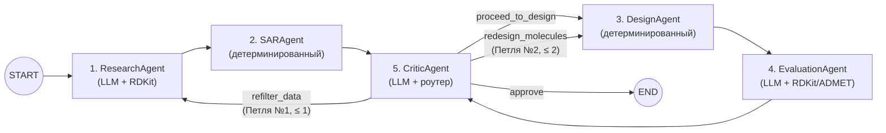

# Pishovichok

Мультиагентная система для ранних этапов drug discovery: курации биоактивности, MMP SAR-анализа, поиска Activity Cliffs (SALI) и направленной оптимизации малых молекул.

## Архитектура

- Детерминированное химическое ядро (`RDKit`, `CReM`, `DuckDB`, `CatBoost`, опционально `AutoDock Vina`) отвечает за генерацию структур, расчет дескрипторов, фильтры PAINS/Brenk и прогнозы ADMET без участия LLM.
- Граф агентов на `LangGraph` включает пять узлов (`ResearchAgent`, `SARAgent`, `DesignAgent`, `EvaluationAgent`, `CriticAgent`) и две петли самокоррекции: повторную фильтрацию неоднородных протоколов `BAO` и перегенерацию кандидатов при нарушении ограничений.
- Трехуровневый каскад LLM (OpenAI-совместимый API → локальная Ollama `qwen2.5:7b` → встроенный Rule-Based движок) позволяет системе работать автономно без доступа к внешним API.



Подробности устройства описаны в [ARCHITECTURE.md](ARCHITECTURE.md) и [SPEC.md](SPEC.md).

## Быстрый старт

### Docker (рекомендуется для Windows и macOS)

Пакет `vina` публикует сборки только для `linux/x86_64`, поэтому вне Linux проще запускать проект в контейнере:

```bash
cp .env.example .env  # опционально, для настройки API-ключей
docker compose up --build
```

Веб-интерфейс откроется на `http://localhost:8080`. Каталоги `data/` и `workspace/` монтируются в контейнер.

Запуск CLI в контейнере:

```bash
docker compose run --rm pishovichok pishovichok -q "Проведи SAR-анализ мишени BTK (CHEMBL5251) и предложи 3 аналога"
```

### Локально через uv (Linux x86_64)

Требуется Python >= 3.12 и [uv](https://docs.astral.sh/uv/):

```bash
uv sync
cp .env.example .env  # опционально
```

Если ключи LLM в `.env` не указаны, система автоматически переключится на Ollama или локальный Rule-Based движок.

## Использование

Веб-интерфейс (NiceGUI Chemical IDE):

```bash
uv run pishovichok --ui
# или
uv run pishovichok-ui
```

CLI:

```bash
# Анализ мишени ChEMBL
uv run pishovichok -q "Проведи SAR-анализ мишени BTK (CHEMBL5251) и предложи 5 аналогов с LogP от 2.0 до 4.0 и SAscore < 3.2"

# Анализ пользовательского CSV
uv run pishovichok -q "Найди перепады активности и предложи модификации" --csv data/samples/custom_wetlab_series.csv
```

Результаты каждой сессии сохраняются в `workspace/<session_id>/`:
- `candidates.csv`, `candidates.sdf` — отобранные кандидаты с рассчитанными свойствами и прогнозами;
- `report.md` — итоговый аналитический отчет;
- `trace_log.json` — журнал работы агентов;
- `curated_dataset.parquet`, `evaluated_candidates.parquet` — табличные срезы сессии.

## Проверка и бенчмарк

Тесты и линтер:

```bash
uv run pytest
uv run ruff check .
uv run ruff format .
```

Результаты абляционного тестирования приведены в [BENCHMARK_REPORT.md](BENCHMARK_REPORT.md), воспроизведение:

```bash
uv run python tools/run_ablation_benchmark.py
```
